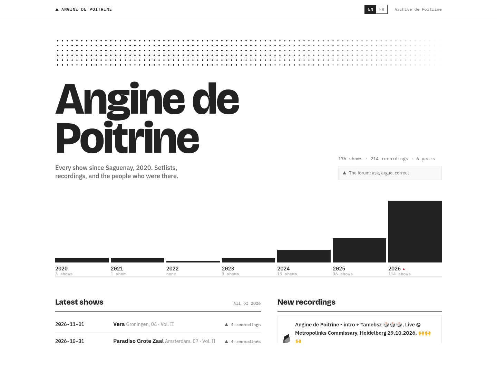
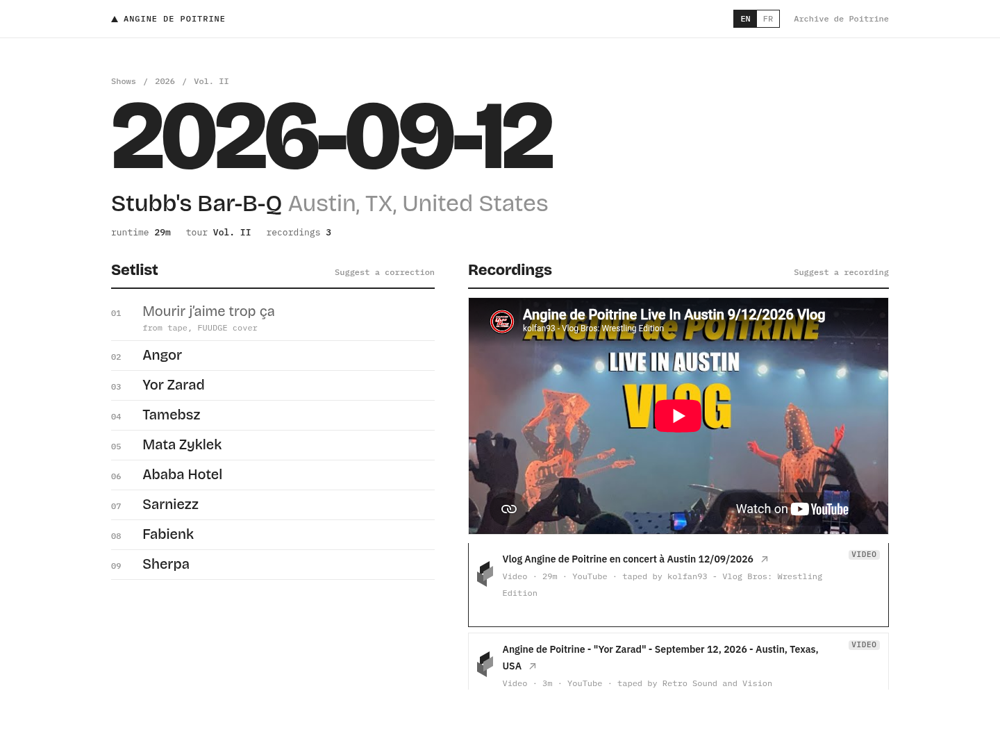
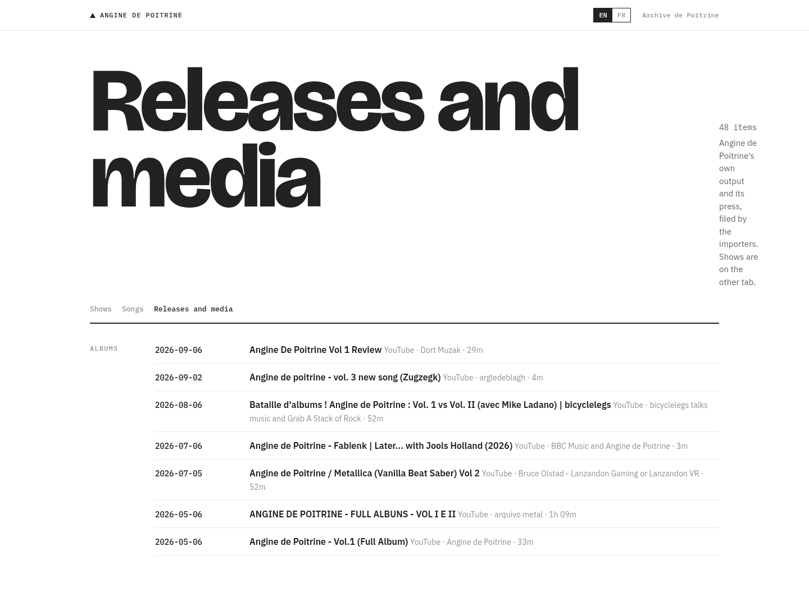

I wanted one place to find Angine de Poitrine shows, setlists, and recordings.
Somewhere to find a tape, talk about the show, and hear from people who were there.

That's now live at [archive.depoitrine.com](https://archive.depoitrine.com).

At launch it had 176 shows, 214 recordings, and 48 media items. Getting it off
my machine and onto an actual hostname felt pretty damn good.

The software underneath is [Taper](https://github.com/ducks/discourse-taper),
a Discourse plugin. Which probably surprises nobody who has read this blog
for a while.

## A show is a topic

I keep finding reasons to build things inside Discourse. With
[the itinerary plugin](/blog/2026/building-discourse-itinerary/), a trip was
a topic with other topics attached to it. Here, each show has a topic, and
the plugin stores the structured music data alongside it: band, date,
venue, setlist, recordings.

The topic gives people somewhere to talk about the show. Someone can add a
memory, point out a mistake, or explain that the recording labeled Austin
is actually from a different night. Accounts, permissions, moderation,
and the discussion itself are already there.

The public pages are rendered on the server with Rails templates. You can
browse the years, songs, shows, and recordings without loading the Ember
app. The review queue and administration use Discourse's app, and a theme
component gives this particular archive its look. The plugin owns the music
data and behavior; the theme owns the Angine de Poitrine presentation.

## Finding videos is the easy part, sort of

Taper checks YouTube, Archive.org, and setlist.fm. They each host different
things. YouTube has performances and clips. Archive.org has recordings and
their metadata. setlist.fm has dates, venues, and what the band played.

The hard part is deciding whether two pieces of information describe the
same night.

A video might have a date in its title. It might have an ambiguous date.
It might have no date at all, but mention a venue. The venue might be
spelled three different ways. And the upload date tells you when somebody
uploaded the video, which is not necessarily when the show happened.

Searching for the band also finds interviews, official videos, reaction
videos, and news reports. Some belong on the media shelf and some don't belong
in the archive at all. A search result is evidence to inspect, not enough
on its own to call something a recording of a show.

## The queue had to get better

An earlier version grouped recordings into bundles. That was convenient
for importing but annoying for reviewing. A bundle could contain several
good recordings and one thing that clearly wasn't a show. Accepting the
whole thing was too coarse.

The review flow now groups work by band and date, but lets a reviewer split
recordings into separate suggestions and choose the show each belongs to.

## Next

Angine de Poitrine is the first band I'm running this for, but Taper already
keeps bands separate. I'd like somebody else to put it to work for a band
they care about. Their shows, their recordings, their own look.

What I'm looking forward to now is someone showing up with a recording I
haven't found, or recognizing the venue in a badly labeled video because
they were there. That's a pretty good reason to build an archive on a forum.
